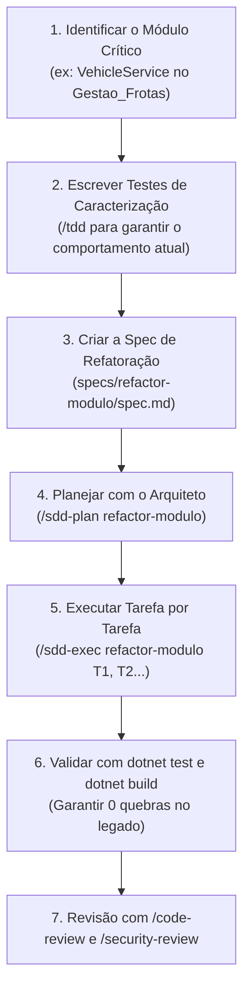

# 🔄 Como Aplicar esta Estrutura (SDD + ECC + Antigravity) em Projetos Existentes (Brownfield)

> **Guia Prático de Migração e Refatoração Segura** para sistemas legados ou em andamento no ecossistema .NET, utilizando como estudo de caso real o projeto **`D:\Dev\Gestao_Frotas`**.

---

## 📌 Sumário
1. [O Desafio de Sistemas em Andamento (Greenfield vs. Brownfield)](#-o-desafio-de-sistemas-em-andamento)
2. [O Princípio Central: O Padrão Estrangulador (Strangler Fig Pattern)](#-o-princípio-central-o-padrão-estrangulador)
3. [Passo 1: Injetando a Inteligência (.agent e specs) no Projeto Existente](#-passo-1-injetando-a-inteligência-no-projeto-existente)
4. [Passo 2: Diagnóstico e Linha de Base (Baseline)](#-passo-2-diagnóstico-e-linha-de-base-baseline)
5. [Passo 3: A Estratégia de Duas Trilhas](#-passo-3-a-estratégia-de-duas-trilhas)
   - [Trilha A: Novas Funcionalidades (O Código Novo Já Nasce Perfeito)](#trilha-a-novas-funcionalidades-o-código-novo-já-nasce-perfeito)
   - [Trilha B: Refatoração Gradual via Specs (Spec-Driven Refactoring)](#trilha-b-refatoração-gradual-via-specs)
6. [Passo 4: Ativando a Camada de Testes Automatizados (Estudo Gestão de Frotas)](#-passo-4-ativando-a-camada-de-testes-automatizados)
7. [Passo 5: O Ciclo de Refatoração Segura (Sem Quebrar Produção)](#-passo-5-o-ciclo-de-refatoração-segura-passo-a-passo)
8. [Checklist Resumo de Migração](#-checklist-resumo-de-migração)

---

## 🧩 O Desafio de Sistemas em Andamento

Quando iniciamos um projeto do zero (*Greenfield*), é fácil seguir 100% da arquitetura limpa. Porém, na vida real, a maioria dos projetos já está em produção ou em andamento (*Brownfield*), como o **`Gestao_Frotas`**.

Nesses projetos, é comum encontrar:
- Controllers injetando `DbContext` diretamente ou serviços com regras de negócio e infraestrutura misturadas;
- Entidades de banco sendo expostas diretamente nas views ou controllers;
- Métodos síncronos ou sem `CancellationToken`;
- Falta de testes automatizados ou cobertura baixa;
- Centenas de *warnings* de nullable reference types.

> ⚠️ **O Grande Erro**: Tentar refatorar o sistema inteiro de uma vez ("*Big Bang Refactoring*").  
> **Resultado**: O sistema para de compilar, telas quebram em produção, geram-se conflitos gigantescos no Git e a equipe perde a confiança na IA.

---

## 🌿 O Princípio Central: O Padrão Estrangulador

A abordagem correta e recomendada pela engenharia moderna de software é o **Strangler Fig Pattern (Padrão Estrangulador)**:

1. **Não mexa no código legado que está funcionando silenciosamente.**
2. **Todo código NOVO já nasce 100% dentro da metodologia (SDD + ECC).**
3. **O código antigo é refatorado apenas sob demanda (fatia por fatia), usando Specs de Refatoração.**

Com o tempo, o código moderno envolve e substitui o código legado com **zero risco** para o negócio.

---

## 🚀 Passo 1: Injetando a Inteligência no Projeto Existente

Você não precisa reescrever o projeto nem recriar a solution. Basta injetar a pasta de inteligência `.agent/` e os moldes de `specs/` na raiz do seu projeto existente.

### Exemplo Prático (Aplicando no `D:\Dev\Gestao_Frotas`):

Abra o terminal PowerShell e execute:

```powershell
# 1. Copiar as pastas de inteligência do template para o projeto existente
Copy-Item -Recurse -Force "D:\Dev\MeuTemplateAspNet\.agent" "D:\Dev\Gestao_Frotas\.agent"
Copy-Item -Recurse -Force "D:\Dev\MeuTemplateAspNet\specs"  "D:\Dev\Gestao_Frotas\specs"
```

### O que acontece imediatamente:
- Ao abrir a pasta `D:\Dev\Gestao_Frotas` no **Antigravity**, todos os agentes (`architect`, `tdd-guide`, `security-reviewer`), todos os workflows (`/sdd-plan`, `/sdd-exec`, `/security-review`, `/code-review`, `/tdd`) e a `constitution.md` ficam **ativos instantaneamente**!

---

## 🔍 Passo 2: Diagnóstico e Linha de Base (Baseline)

Antes de alterar qualquer código, tire uma "fotografia" do estado de saúde do sistema atual:

### 1. Verificar a Compilação
```powershell
dotnet build GestaoFrotas.sln
```
> *No caso do `Gestao_Frotas`, vimos que ele compila com 0 erros e 263 warnings. Esse é o seu ponto de partida.*

### 2. Rodar a Auditoria de Segurança do ECC
No chat do Antigravity aberto na pasta do projeto, digite:
```text
/security-review
```
O agente vai mapear:
- Secrets ou connection strings expostas em arquivos `appsettings.json`;
- Endpoints ou actions sem autenticação/autorização;
- Vulnerabilidades potenciais a SQL Injection ou brechas de injeção.

### 3. Avaliar a Qualidade de um Módulo Específico
Abra uma classe que você desconfia que precise de melhorias (ex: `VehicleService.cs`) e chame:
```text
/code-review
```
O agente vai destacar acoplamentos excessivos, falta de tratamento de exceções e uso incorreto de chamadas síncronas/assíncronas.

---

## 🛤️ Passo 3: A Estratégia de Duas Trilhas

Após injetar a estrutura no projeto existente, seu trabalho se divide em duas trilhas muito claras:

### Trilha A: Novas Funcionalidades (O Código Novo Já Nasce Perfeito)
Quando o cliente ou o produto pedir uma **nova tela ou funcionalidade** (ex: *Módulo de Abastecimento de Combustível* no Gestão de Frotas):

1. **Não misture com o legado**: Crie uma pasta `specs/01-abastecimento-combustivel/` a partir do molde `specs/_template/`.
2. **Escreva o `spec.md`**: Descreva as regras (litros, odômetro, posto, valor, comprovante).
3. **Execute o `/sdd-plan 01-abastecimento-combustivel`**: O Arquiteto projeta a nova funcionalidade respeitando as regras modernas (Entidades no `GestaoFrotasIO.Bussiness`, Mapeamento no `GestaoFrotasIO.Data`, DTOs records e Controllers assíncronos no `GestaoFrotasIO.App`).
4. **Execute `/sdd-exec` tarefa por tarefa**: O código novo já nasce limpo, testado e com 0 dívida técnica.

---

### Trilha B: Refatoração Gradual via Specs (Spec-Driven Refactoring)
E como refatorar um módulo antigo que está difícil de manter (ex: o cadastro de Veículos no `Gestao_Frotas`)?

> ❌ **Como NÃO fazer**: Pedir à IA: *"Refatore o cadastro de veículos para usar Clean Architecture"*.  
> (A IA vai reescrever 20 arquivos, quebrar o banco, quebrar as Views Razor e nada mais vai compilar).

> ✅ **Como FAZER com SDD**: Criar uma **Spec de Refatoração**!

#### Exemplo Prático de Spec de Refatoração:
Crie a pasta: `specs/refactor-veiculos/` copiando o molde `specs/_template/`.

No arquivo `specs/refactor-veiculos/spec.md`:
```markdown
# Refatoração do Módulo de Veículos (Gestão de Frotas)

## 1. Problema Atual
- `VehicleService.cs` possui métodos síncronos e misturados com lógica de validação.
- As Views consom entidades de domínio diretamente em vez de DTOs imutáveis.
- O código atual gera warnings de nullable reference e não possui testes unitários.

## 2. Objetivo da Refatoração
- Isolar as regras de validação e regras de negócio no serviço.
- Converter operações de I/O para `async/await` com `CancellationToken`.
- Introduzir DTOs Records para Request e Response.
- **RESTRIÇÃO INEGOCIÁVEL**: Manter os contratos existentes de rotas e dados para NÃO QUEBRAR as Views Razor e chamadas existentes.

## 3. Critérios de Aceite
- Todas as funcionalidades atuais de Veículo (Listar, Cadastrar, Editar, Excluir) continuam funcionando idênticas para o usuário final.
- `dotnet build` compila com 0 erros.
- Criação de testes unitários cobrindo os cenários principais.
```

Em seguida, chame no chat:
```text
/sdd-plan refactor-veiculos
```
O Arquiteto vai criar um `plan.md` e um `tasks.md` seguro, dividindo a refatoração em micropassos sem quebrar o sistema!

---

## 🧪 Passo 4: Ativando a Camada de Testes Automatizados

No nosso diagnóstico do `D:\Dev\Gestao_Frotas`, descobrimos que a pasta `tests/GestaoFrotasIO.Tests` não tinha um projeto de teste configurado.

Para refatorar qualquer código antigo com segurança, **precisamos de testes**. 

### Como ativar os testes no projeto existente em 3 comandos:

```powershell
cd D:\Dev\Gestao_Frotas

# 1. Criar o projeto de testes xUnit na pasta tests
dotnet new xunit -n GestaoFrotasIO.Tests -o tests/GestaoFrotasIO.Tests

# 2. Adicionar o projeto à Solution existente
dotnet sln GestaoFrotas.sln add tests/GestaoFrotasIO.Tests/GestaoFrotasIO.Tests.csproj

# 3. Referenciar o projeto de negócio que você quer testar
dotnet add tests/GestaoFrotasIO.Tests/GestaoFrotasIO.Tests.csproj reference src/GestaoFrotasIO.Bussiness/GestaoFrotasIO.Bussiness.csproj
```

Agora, antes de refatorar qualquer método antigo, você pede ao Antigravity:
```text
/tdd "Criar testes de caracterização para os métodos principais do VehicleService"
```
Ele escreve testes que garantem que o comportamento atual está gravado em pedra. Se na hora da refatoração você alterar algo sem querer, os testes acusarão o erro imediatamente!

---

## 🔄 Passo 5: O Ciclo de Refatoração Segura (Passo a Passo)

Sempre que for refatorar uma parte de um sistema existente:



---

## 📋 Checklist Resumo de Migração

Quando você for aplicar esta metodologia em qualquer projeto da sua máquina (`Gestao_Frotas`, `bot-restaurante-js`, `WebApi`, etc.):

- [ ] **1. Copiar as pastas**: Copie `.agent` e `specs` para a raiz do projeto.
- [ ] **2. Checar a Solution**: Verifique se `dotnet build` executa sem erros impeditivos.
- [ ] **3. Garantir projeto de testes**: Se o projeto não tiver testes, crie o projeto `xUnit` e vincule à solution.
- [ ] **4. Auditoria inicial**: Execute `/security-review` para identificar vazamento de senhas e vulnerabilidades.
- [ ] **5. Novas features**: Faça 100% via `specs/nome-feature/` com `/sdd-plan` e `/sdd-exec`.
- [ ] **6. Código legado**: Só refatore criando uma spec de refatoração (`specs/refactor-.../`) e com testes garantindo o comportamento anterior.

---

> 💡 **Lembre-se da Regra do Escoteiro**:  
> *"Deixe o código sempre um pouco mais limpo do que quando você o encontrou."*  
> Você não precisa reescrever o `Gestao_Frotas` inteiro em uma semana. Cada vez que você for dar manutenção ou criar algo novo, aplique uma Spec. Em pouco tempo, o sistema estará 100% moderno, blindado e testado!
